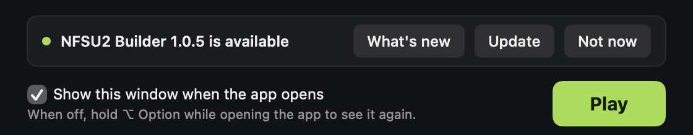
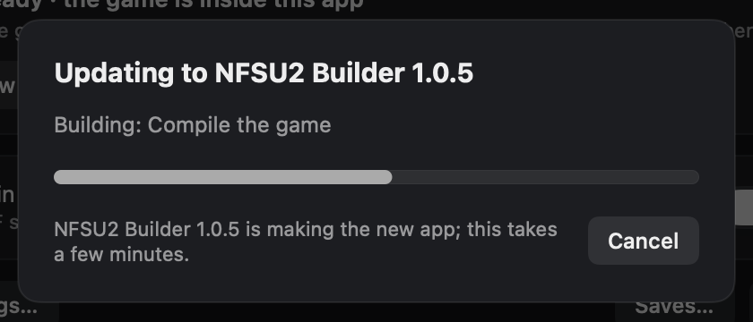
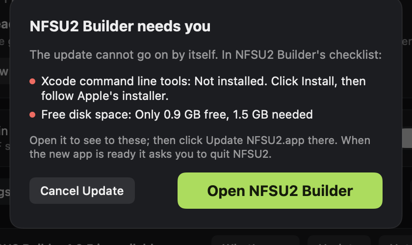
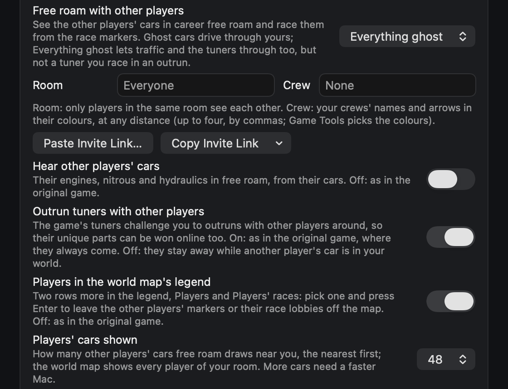
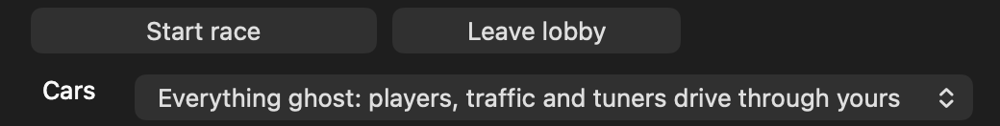
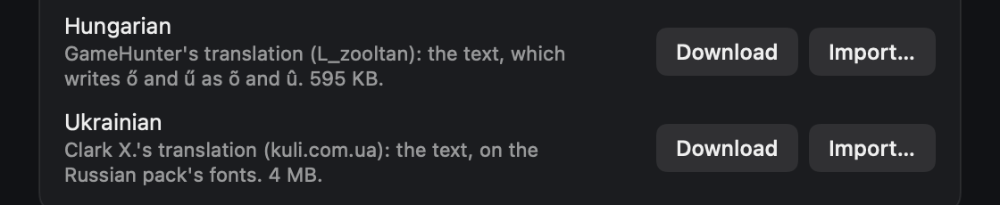
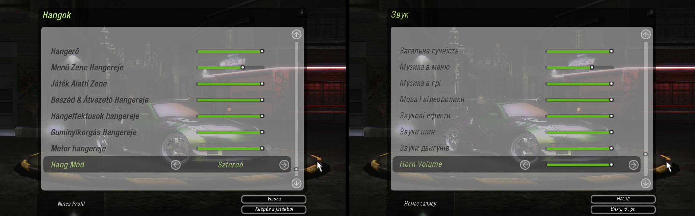

# Changelog

What each version of NFSU2 Builder brings. The newest version is first.

## 1.0.6 - unreleased

### Added
- Czech: ROXOR's and PINĎA & syn's Czech translation (v1.1, 2004) with our own edits, one click in Settings, Mods, Languages. The launcher downloads it from abcgames.cz, checks it is the tested release and reads its files without running its patch program. It is written as the translation wrote it, without the letters with the caron (c, r, s for č, ř, š), which the game's fonts lack. The texts it had left in German (gamepad help, colours, countries, console messages) are in Czech now, and so are the movies' subtitles, which it had left empty.
- Slovak: MixerX's Slovak translation (v1.0, 2011), one click in Settings, Mods, Languages. The launcher downloads it from abcgames.cz, checks it is the tested release and reads its files without running its installer. It has every Slovak letter, drawn by the fonts it comes with, and the movies' subtitles. Import… also takes its installer for the American game.

## 1.0.5 - 2026-11-03

### Added
- Update in one click: the launcher's notice for a newer NFSU2 Builder has an Update button. The launcher downloads the new Builder, checks it against the release's SHA-256, and the Builder makes the new app in the background from the game inside yours. One progress bar in the launcher shows each step, and Play waits until it is done. When the new app is ready the launcher closes, NFSU2.app is replaced and opens again by itself. An app not named NFSU2.app, or in a folder you cannot write to, keeps the Download button.
  
  
- When the update cannot go on by itself (the command line tools are missing, the game in the app has changed, the disk is full), the launcher lists what NFSU2 Builder's checklist shows and opens the Builder, where you see to it. A step that fails says which and why, with Copy Log.
  

### Changed
- The launcher looks for a newer Builder every two hours, also while it stays open, instead of once a day.
- NFSU2 Builder keeps its Python packages between versions, so an update no longer downloads them again. Delete temporary files leaves the build tools (Python and its packages) unless you also tick Also delete the build tools.

## 1.0.4 - 2026-11-03

### Added
- Everything ghost: a third choice for free roam with other players, where the game's traffic and tuners drive through your car too, and give no near-miss points. A tuner you race in an outrun stays solid, and an outrun between two players is solid only when both chose solid cars. Game Tools switches between solid, ghost and everything ghost while you play.
  
  
- Quick chat in races with other players: the same phrases, keys 1-4 twice or the right stick, while driving and on the results of every race between players online (the Online and LAN menus' races and free roam's race lobbies), with free roam on or off. What is said shows in a chat on the left of the picture. Never in a career race or a Quick Race; from th0mk's nfsu2-web.
- Players' cars shown in Settings, Online: 16 to 48 other players' cars near you in free roam, 32 by default.
- Hungarian and Ukrainian: GameHunter's Hungarian translation (L_zooltan) and Clark X.'s Ukrainian one, one click each in Settings, Mods, Languages. The launcher downloads the translation's installer, checks it is the tested release and reads its files without running it.
  
  

### Changed
- Free roam speaks the community server's free-roam version 11: the server links you with as many players as you show cars, and keeps an outrun's two players linked however many others come between them, so an outrun in a crowd no longer ends with both players winning.
- A car that stays in the air for two minutes in free roam takes its player off the server for the rest of that session, as a kick does, with a line saying why.

## 1.0.3 - 2026-11-03

### Added
- Unique parts for every car: once Caleb is beaten, the career shops sell the unique visual parts, the wide body kits too, for every car, as the game already does in Customize mode. A switch in Settings, Game; off as in the original game.

### Changed
- The game sends the server fewer messages: what it has to send at once goes in one bundle, as the browser version does, and it asks for bundles back.

### Fixed
- Music and sound no longer cut out on busy Macs: the game's sound loops wake on time (the original project's Audiofix).
- Other cars' headlights no longer light the street under an overpass.
- A kick, a ban or a name taken away by the server now says so in the game and keeps the game off the server for that session, instead of reconnecting again and again.
- A career whose saved car position was broken (a black screen under the HUD after loading) starts at the airport's car park again.

## 1.0.2 - 2026-11-02

### Added
- Check Now in Settings, More asks GitHub for a newer NFSU2 Builder at once, instead of waiting for the daily check, and says what it found. It works with the daily check off too, and brings back an update notice you hid with Not now.

### Changed
- The launcher and Finder show the version of NFSU2 Builder that made the app, such as 1.0.2, instead of the engine's internal 2.0.

## 1.0.1 - 2026-11-02

### Added
- Settings checks your online player name on the server and lets you claim it with your cloud saves keyphrase, so nobody else can play under it there. If another player claimed the name, the launcher offers one with four digits added, or you can play under it anyway.
- The free-roam world map shows up to 2048 players of your room, and their markers move while the map is open.
- Online statistics: a small panel in a corner of the game shows your connection, the round trip to the server, how many play on the server, in free roam, in the Online lobby, in your room and in your crews, and how many cars are shown near you. A switch in Settings, Online; off as in the original game.
- Friends: add players by name in the launcher, or by touching front bumpers for three seconds in free roam. Friends show in their own colour, you get a notice when one starts free roam, and Join takes you to their room. Needs a claimed name.
- Invite links: copy a link to your free-roam room or crew and paste one in the launcher to join it. Game Tools can change the room while you play.
- The game's own outrun challengers drive in free roam with other players around, greyed on the minimap and the world map. Both have a switch in Settings.
- The world map's legend can hide other players and their races.
- Photo mode: a farther camera, and names over the cars (your own too) with N. Tab and N switch back.
- Show hidden races: the career map shows the races the game hides, as the Show Hidden Races mod does. Off as in the original game.
- Exposure and White Level in the Display options, for a picture that tires the eyes less. The original game's values by default.
- Your first profile's name starts with your player name.

### Changed
- Free roam works with the community server's new free-roam version (core version 9).
- Room and crew names match even when friends type them a little differently: capitals (Greek and Cyrillic too), spaces and invisible characters do not count. The launcher's player counts for your room and crews follow the same rule.
- Drift mode in free roam uses the drift races' handling and your car's Drift tuning, and keeps your nitrous.
- Less input lag: the controller is read after the wait for the next frame.
- Replays above 60 fps run in step with the race.
- The game sends the server less: it asks only for changes to the list of players, and only for the LAN broadcasts it listens for.

### Fixed
- Online play no longer reconnects every second on a busy server, which kept the Online menu at Connecting to lobby.
- The game no longer crashes when your car touches another player's car in free roam.
- Free roam's Loading screens no longer drag on, or never end, with many players around: the city's sections load before other players' cars.
- In Online races, the other players' cars come straight from each player and their corrections are smoothed, so they jump less.
- Your car keeps its spoiler and exhaust tips after a shop in free roam with other players.
- A failed magazine or DVD cover save no longer garbles your profile's name.
- LAN play's network clock can no longer step backwards.
- A key held while you switch to another app and back works again on its next repeat.

## 1.0.0 - 2026-11-01

### Added
- NFSU2 Builder makes NFSU2.app on your Mac from your own game: your installed folder or the two PC disc images, European or North American v1.2. A checklist fixes each missing item with one button, and no Terminal is needed.
- The game runs as native Apple Silicon code with Metal graphics and CoreAudio sound. No Wine, CrossOver or emulator. The app holds the game inside it, so you can move it anywhere, and saves and settings stay outside.
- LAN play between Macs and Windows PCs, and the game's Online mode through a community server.
- Free roam with friends: see other players' cars live in career free roam, challenge them to outruns or open a race lobby at a race marker, with rooms, crews, quick chat and horns.
- A launcher where every optional feature has a switch that names the original game's value. Restore Original Game turns them all back.
- Graphics options: 30 to 240 FPS with speed and physics kept as at 60, resolution scale, sharper reflections, picture options without the yellow-green tint, other cars' headlights and 60 FPS cutscenes.
- One-click mods: the Upscaled HUD, community texture packs, data mods, 4x upscaled textures built from your own files, and language packs. 16 languages in all.
- Better controls: typing on every Mac keyboard layout, key rebinding that is kept, and game controllers with dead zones and rumble.
- Career extras: a 10-car garage with Trade Car, power in bhp or kW, both regions' cars, photo mode, drift mode in free roam, your own music through EA Trax and encrypted cloud saves.
- Fixes for the original game: the car lot opens on damaged profiles, the Performance Shop no longer locks up after Nitrous, the music keeps playing after shops, and Cmd-Q quits safely.
