# Need for Speed: Underground 2 on Mac — native Apple Silicon port, no Wine

> **This is a fork** of [TalhaMudo/NFSU2Recomp](https://github.com/TalhaMudo/NFSU2Recomp):
> upstream's main plus features upstream does not have. They are all optional and
> off (as in the original game) unless noted; see [This fork](#this-fork) for the
> list. This fork's app is made on your own Mac by [NFSU2 Builder](#nfsu2-builder);
> upstream's Releases page has upstream's builds, without this fork's features.

**Play *Need for Speed: Underground 2* (NFSU2, 2004) natively on Apple Silicon
Macs (M1 and later): no Wine, no CrossOver, no emulator, no virtual machine.**

NFSU2Recomp is a static recompiler and runtime that turn the original Windows PC
executable of the game (`SPEED2.EXE`, 32-bit x86, Direct3D 9) into a **native
ARM64 macOS app**. The game's x86 machine code is lifted to C ahead of time and
compiled with clang; Direct3D 9 is translated to Metal, DirectSound to
CoreAudio. There is no Wine, no emulator, no JIT and no Windows involved at run
time. On an M1 Pro, races run at **119 fps** (the display's limit), against
**10–15 fps** for the same game under Wine.

> **This repository contains no game code and no game assets.** It contains the
> recompiler and the runtime only. You need your own copy of the game. The C
> code generated from its executable is never committed. This fork ships no
> ready-made app: [NFSU2 Builder](#nfsu2-builder) recompiles your own `SPEED2.EXE`
> on your Mac.

<a href="https://github.com/user-attachments/assets/f58f98bd-ca90-48fa-9a7d-5d056cf0cbbb">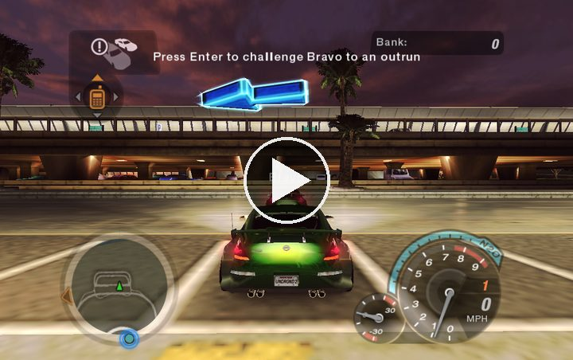</a><br>
<sub>Click to watch the gameplay video</sub>

## This fork

This fork follows upstream's main and adds what upstream is missing or declined,
for both game versions (European and North American v1.2). Each optional feature
has a switch in the launcher that says what the original game does, and
**Settings > Restore Original Game** turns them all back.
[`docs/fork-tracker.md`](docs/fork-tracker.md) lists every feature with its state.

### NFSU2 Builder

This fork has no ready-made app to download. You get **NFSU2 Builder**, a small
app that makes `NFSU2.app` on your own Mac from your own copy of the game. There
is no Terminal and no scripts: each missing item is a red row with a button that
fixes it. Click a picture to see it full size.

<table>
<tr>
<td align="center"><a href="docs/readme/builder/checklist-green.png">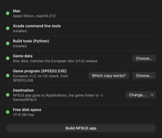</a><br><sub>Ready to build</sub></td>
<td align="center"><a href="docs/readme/builder/checklist-red.png">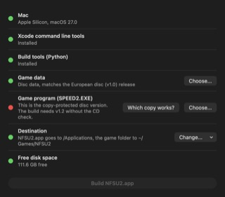</a><br><sub>A red row says what to fix</sub></td>
<td align="center"><a href="docs/readme/builder/which-copy.png">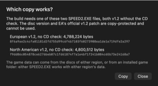</a><br><sub>Which SPEED2.EXE works</sub></td>
</tr>
<tr>
<td align="center"><a href="docs/readme/builder/progress.png">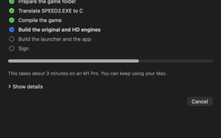</a><br><sub>Building, about 3 minutes</sub></td>
<td align="center"><a href="docs/readme/builder/ready.png">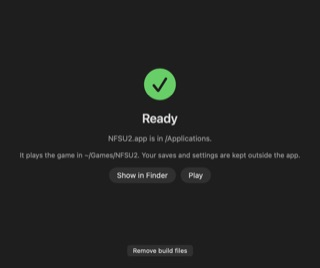</a><br><sub>Done, click Play</sub></td>
<td align="center"><a href="docs/readme/builder/dmg.png">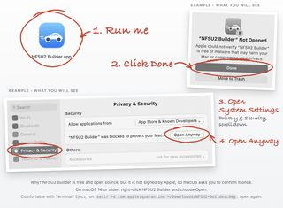</a><br><sub>Opening it the first time</sub></td>
</tr>
</table>

1. Download `NFSU2-Builder.dmg` from this fork's [Releases page](https://github.com/007hacky007/NFSU2-macOS-native/releases/latest) and open it.
2. Double-click **NFSU2 Builder**. macOS blocks it the first time because Apple has
   not signed it: click **Done**, then open System Settings > Privacy & Security,
   scroll down and click **Open Anyway**. The disk image shows where. On macOS 14 or older, right-click
   NFSU2 Builder and choose Open.
3. Press the button on each red row. **Choose...** under Game data takes your game
   folder or the two disc images.
4. Click **Build NFSU2.app**, then **Play**.

The app it makes has the game inside it, so it needs no game folder and you can move
it anywhere.

**Updating.** The launcher of an app the Builder made asks GitHub whether a newer
NFSU2 Builder is out when it opens and every two hours while it stays open, and if so
says so with **What's new** and **Update** (Settings > More > Check for updates turns
this off; off, it makes no network request). **Update** does the rest by itself, with
one progress bar in the launcher: it downloads the new Builder's disk image, checks it
against the release's SHA-256, opens the Builder in it out of sight, and the Builder
builds the new app from the game inside your `NFSU2.app`. Play waits meanwhile. When
the new app is built the launcher closes, the Builder replaces `NFSU2.app`, opens it
and quits, and the launcher unmounts the disk image and deletes the download. If
anything stops it, the launcher says why (**Show Details** opens the Builder with its
log) and your app stays as it was. An app not named `NFSU2.app`, or in a folder you
cannot write to, gets **Download** instead: open the new Builder yourself, it finds
your `NFSU2.app`, takes the game from inside it, and the button reads **Update
NFSU2.app** with the old and new versions. Either way the old app is only read, and it
is replaced only once the new one is complete. Saves and settings stay as they are.

What you need:

- **An Apple Silicon Mac** (M1 or later) with macOS 11 or later. The Builder
  installs Apple's command line tools (about 2 GB) and its own Python (about
  32 MB) when you press **Install**.
- **The game data:** your installed game folder, or the two PC disc images
  (`.iso`, `.cue`/`.bin`, or disc folders). Either region works. A copy with
  other files (another language, a repack, mods) gets an amber note and still
  builds.
- **The game program:** `SPEED2.EXE` v1.2 without the CD check, European or North
  American ([Game versions](#game-versions) lists both with size and SHA-256).
  If your game folder doesn't have it, choose the file itself or a zip, rar or 7z
  archive that holds it. The disc version and EA's official v1.2 patch are
  copy-protected, so the Builder refuses them and says why.

<details>
<summary>What the Builder does, how long it takes, what it downloads</summary>

It runs the same scripts as [Build from Terminal](#build-from-terminal) from a
copy of the sources inside the app. It builds the original and HD engines for
your `SPEED2.EXE`'s region and puts `NFSU2.app` in `/Applications` (or a folder
you choose), with the game inside it (`Contents/Resources/Game`, about 1.8 GB):
your game files, or the unpacked discs, plus the supported `SPEED2.EXE`. On the
same disk the game files are APFS clones, so they take no extra space; from
discs or another disk they are copied. The app needs no game folder and can be
moved anywhere. Your own copy, disc images and archives are only read. An
existing `NFSU2.app` with the game inside can be the game data too (an update),
but only when the game in it still matches the list of files, sizes and SHA-256
checksums written next to it at build time (`Contents/Resources/game-files.tsv`);
an app from the first 1.0.0 Builder has no such list, so choose your original game
copy once and later updates reuse the new app.

On an M1 Pro the build takes about 3 minutes: lifting 52 s, compiling 57 s,
linking 10 s and the launcher 60 s (a rebuild skips the launcher). The first
time, add about 1.5 minutes for the Python download and setup. It needs about
1.5 GB of free space while building (0.6 GB stays per region built until you
press **Delete temporary files**; the build tools, about 110 MB, stay unless you
also tick **Also delete the build tools**, so an update does not download them
again), and about 1.8 GB more for the game when it cannot
be cloned: unpacked from disc images, or copied from another disk.

The Builder works in `~/Library/Application Support/NFSU2 Builder` and never
touches your system's Python or Homebrew. It downloads only its Python
(python-build-standalone, checked against a pinned SHA-256) and the packages in
`requirements.txt`. It never downloads the game, a game program or a patch.
Saves and settings live outside the app (`~/Library/Application Support/NFSU2
Saves`, `~/.nfsu2_registry`), so building again keeps your progress. Nothing is
ever written inside the app (that would break its signature): language packs the
launcher makes go to `~/Library/Application Support/NFSU2/LanguagePacks`.

</details>

### What this fork adds

Click a picture to see it full size.

| Feature | What it does for you | Picture |
|---|---|---|
| **Online and free roam** | | |
| LAN play | Race Macs and Windows PCs on the same network, and host LAN games with the game's own server. | |
| Online play | The game's Online mode through a community server, since EA's servers are gone. Your place in a full server survives a reconnect. Off by default. | <a href="docs/readme/full/online-lobby.jpg">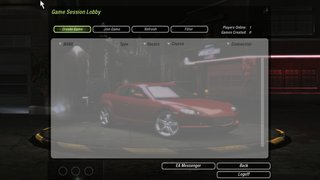</a> |
| Free roam with friends | See up to 48 other players' cars live in career free roam, as solid cars or ghosts (traffic and tuners too if you like), with rooms (invite links to share them) and up to four crews in your colours. Off by default. | <a href="docs/readme/full/fr-free-roam-eu-sees-na-ghost.jpg">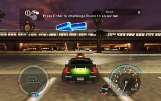</a> |
| Races from free roam | Challenge a nearby player to an outrun, or open a race lobby at a race marker. The prize goes into your career. The game's own tuners still challenge you with other players around. | <a href="docs/readme/full/fr-free-roam-na.jpg">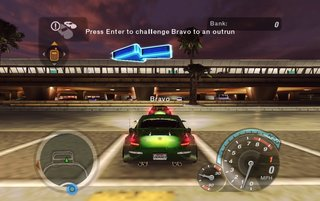</a> |
| Quick chat and Game Tools | Say short phrases with keys 1-4 or the right stick, shown as bubbles over your car in free roam and in a chat on the left in races with other players. Cmd+Shift+M opens the free-roam race lobby and changes your room while you play. Off by default. | <a href="docs/readme/launcher/quick-chat.png">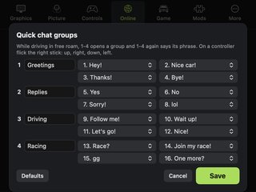</a> |
| Horns and friends' cars | Honk at other players with N (eight horns), and hear their engines, nitrous and hydraulics. Both off by default. | <a href="docs/readme/full/ph-horns-pause-audio-eu.jpg">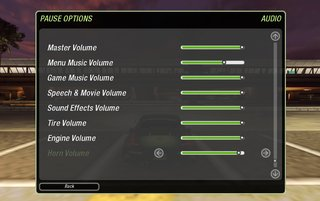</a> |
| Friends | Touch front bumpers with another player in free roam to become friends; friends stand out in free roam, and the launcher lists where each one plays with a Join. Needs a claimed name. |  |
| Player counts | See how many play on the server, in your room and in your crews before you join. | <a href="docs/readme/launcher/settings-online.png">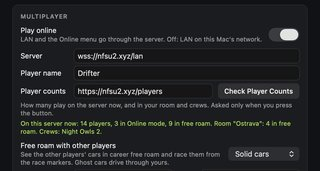</a> |
| Online statistics | A small panel in the game's corner while you play online: the connection or your place in the server queue, the round trip to the server, and how many play on the server, in free roam, in the Online lobby, in your room and crews. Off by default. | |
| Better online races | Every track, up to 6 players, 2 laps by default, a lobby filter that works, and you log in under your own name. | |
| Show in Discord | Your Discord status shows the game and the race you are in. Off by default. | <a href="docs/readme/launcher/settings-game.png">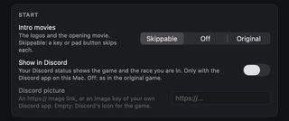</a> |
| **Input** | | |
| Mac keyboard | Typing works on every keyboard layout, with accents and Option as Alt, as on Windows. A key held through Cmd-Tab and back drives again with its next autorepeat. | |
| Key rebinding | Rebinding keys in the game's Controls menu works and is kept, with Mac key names. | |
| Game controller | Separate trigger axes, bindings that stay between sessions, menus driven by the pad, dead zones, and a choice of what happens when it is unplugged. | <a href="docs/readme/launcher/settings-controls.png">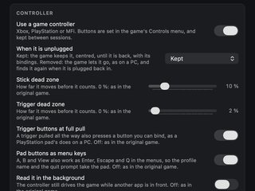</a> |
| Rumble | The controller vibrates with the game's force feedback, optionally on crashes too. Off by default. | <a href="docs/readme/launcher/settings-controls.png">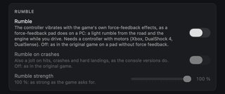</a> |
| **Graphics** | | |
| Frame rate | Choose 30, 60, 120 or 240 FPS, or follow the screen; speed, physics, smoke and the NOS trail stay as at 60. | <a href="docs/readme/launcher/settings-graphics.png">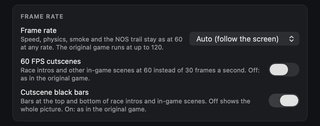</a> |
| Less controller lag | The frame wait comes before the controller is read, as on Windows, and no frame waits behind one the screen has not taken yet. Replays at 120 and 240 FPS play to the end. | |
| Frame-rate counter | Frames per second and frame times in the corner, simple or detailed; Cmd-N switches it. Off by default. | <a href="docs/readme/full/fps-counter.jpg">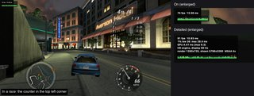</a> |
| Metal performance overlay | Apple's Metal HUD in the top right corner: frame rate, GPU time, frame interval and memory, for checking performance. Off by default. | <a href="docs/readme/full/metal-hud.jpg">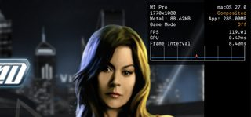</a> |
| Other cars' headlights | Other players' headlights light the road, or every car's. Single player looks as before unless you pick All cars. | <a href="docs/readme/full/other-headlights.jpg">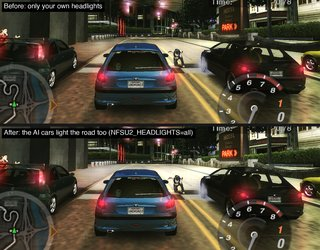</a> |
| Sharper reflections | Sharper wet road, mirror and car paint, with the sky, car lights and more detail in them. Off by default. | <a href="docs/readme/full/hr-mirror-eu.jpg">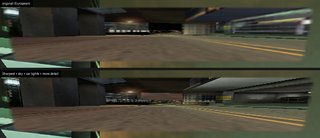</a> |
| Picture options | Remove the PC version's yellow-green tint, the console gamma, edge smoothing and sharpening. Off by default. | <a href="docs/readme/full/vo-colour-eu.jpg"></a> |
| Resolution scale | Draw at 50 to 200% of the window's pixels: faster or sharper. | <a href="docs/readme/launcher/settings-graphics.png">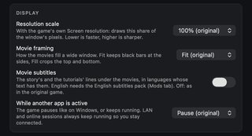</a> |
| Exposure and White Level | The whole picture from half to twice as bright, and its brightest parts brought down to 40-100%, for eyes a bright picture tires (`NFSU2_EXPOSURE`, `NFSU2_WHITE_LEVEL`). Screenshots keep the game's colours. Off by default. | |
| Sharper menus and HUD | One click downloads LunicAura106's Upscaled HUD mod and sets it up; Cmd-T compares. Off by default. | <a href="docs/readme/full/uhud-before-after.jpg">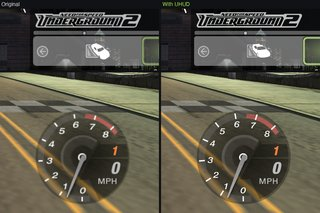</a> |
| Texture packs | The community's texture mods (TexMod, TexWizard and more): 38 listed, 27 with one-click Download, each with its own switch. Off by default. | <a href="docs/readme/full/tp-texpacks-winter-na.jpg">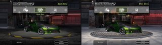</a> |
| Upscaled textures | Builds a 4x sharper copy of the game's own textures from your files, on your Mac. Off by default. | <a href="docs/readme/launcher/upscaled-textures.png">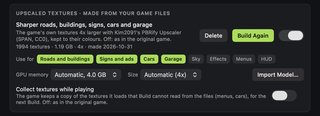</a> |
| Data mods | Detailed Map, Upscaled Freeway Signs and Carbon 4K, downloaded and applied by the launcher; your game folder stays as it is. Off by default. | <a href="docs/readme/full/data-mods-minimap.jpg">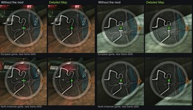</a> |
| Rain on wide screens | Rain drops keep their shape and the rain tint covers the whole screen. | |
| Highest graphics at first start | Start with every graphics option at its highest instead of the game's hardware check. Off by default. | <a href="docs/readme/launcher/settings-graphics.png">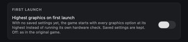</a> |
| **Audio and music** | | |
| Your own music | Play a folder of your music through EA Trax, with artist and title, pause, next and shuffle. Off by default. | <a href="docs/readme/launcher/settings-game.png">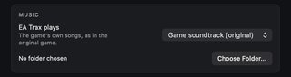</a> |
| Headphones | Sound moves to new headphones or AirPods without restarting the game. | |
| Music after shops | The music no longer stops after you visit a shop. | |
| **Movies** | | |
| Subtitles | Subtitles under the story movies, also in English with a free pack. Off by default. | |
| 60 FPS cutscenes | Race intros and in-game scenes at 60 instead of 30 frames a second, with or without black bars. Off by default. | <a href="docs/readme/full/rate-bars-eu.jpg">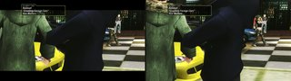</a> |
| Movie framing | Movies fit with black bars, fill the screen, or stretch. | |
| **Career and saves** | | |
| 10-car garage | Ten career garage slots instead of five, and Trade Car for 80% of what you paid. Old saves still load in the original game. | <a href="docs/readme/full/garage-slots-eu-na.jpg">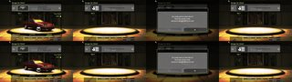</a> |
| Hidden races on the map | The career's 33 hidden races on the map and the radar like the others, up to 8 races of each kind at once, as MaxHwoy's Show Hidden Races Mod (`NFSU2_SHOW_HIDDEN_RACES=1`). Off by default. | |
| Unique parts for every car | Once Caleb is beaten, the career shops sell the unique visual parts (the wide body kits too) for every car, as the game already does in Customize mode; from th0mk's nfsu2-web (`NFSU2_UNIQUES=1`). Off by default: each unique part only for the car that won its star. | |
| Power in bhp or kW | Choose the power unit apart from the speed unit, in Options and the pause menu. | <a href="docs/readme/full/power-units-eu-na.jpg">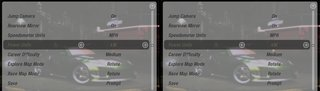</a> |
| Both regions' cars | With all four cars' files, buy and race the Corsa, 106, Civic and RSX in either version. | <a href="docs/readme/full/region-cars.jpg">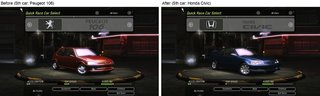</a> |
| Languages | Pick the game's language in the launcher, 18 in all. | <a href="docs/readme/full/language-eu-na.jpg">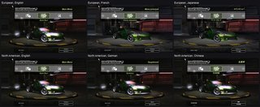</a> |
| Language packs | The launcher downloads and builds packs for the languages your game folder lacks, with voices and movies. | <a href="docs/readme/launcher/settings-mods.png">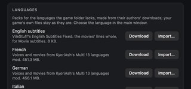</a> |
| Cloud saves | Encrypted cloud saves that also work with the browser version, linked by an 8-word phrase. Off until you link. | <a href="docs/readme/launcher/saves-cloud.png">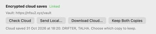</a> |
| Crash fixes | The car lot opens on damaged profiles, and the Performance Shop no longer locks up after Nitrous. | |
| **Photo and drift** | | |
| Photo mode | F12 or the pause menu stops the world, hides the HUD and frees the camera; pictures are saved as PNG. Off by default. | <a href="docs/readme/launcher/settings-game.png">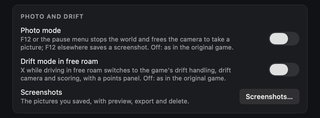</a> |
| Drift mode in free roam | X in free roam switches on drift handling, camera and scoring, with a points panel. Off by default. | |
| Screenshots gallery | See, export and delete your pictures from the launcher. | |
| **Engine** | | |
| Safe quitting | Cmd-Q goes through the game's own shutdown, so a save is never cut in half. | |
| Switching apps | The game pauses when you switch to another app, as on Windows, or keeps running if you choose. | |
| Long sessions | Fairer thread scheduling, memory that lasts long careers, faster loading and car screens, and a log report if the game stalls. | |
| PC-exact math | Physics and timing math rounds like the PC's FPU. | |
| **Launcher** | | |
| Restore Original Game | Every option names the original game's value, and one button sets them all back. | <a href="docs/readme/launcher/settings-graphics.png">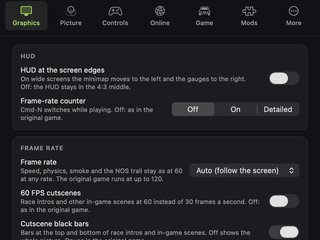</a> |
| **For developers** | | |
| Compiler and tests | x87 precision control, full 128-bit SSE2, override and hook lists derived from the runtime, optional lift options (`LREGS`, `JTSWITCH`, `INLINE_LIST`, `FTOL2INL`, see `LIFTER_EFFICIENCY.md`), and more ISA and runtime checks for both builds. | |

### The launcher

<table>
<tr>
<td align="center"><a href="docs/readme/launcher/main.png">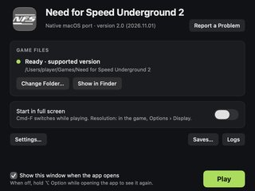</a><br><sub>Main window</sub></td>
<td align="center"><a href="docs/readme/launcher/settings-graphics.png"></a><br><sub>Graphics</sub></td>
<td align="center"><a href="docs/readme/launcher/settings-picture.png">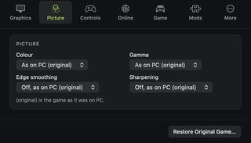</a><br><sub>Picture</sub></td>
<td align="center"><a href="docs/readme/launcher/settings-controls.png">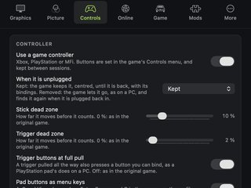</a><br><sub>Controls</sub></td>
</tr>
<tr>
<td align="center"><a href="docs/readme/launcher/settings-online.png">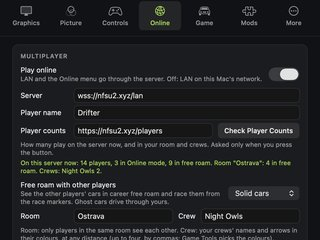</a><br><sub>Online</sub></td>
<td align="center"><a href="docs/readme/launcher/settings-game.png">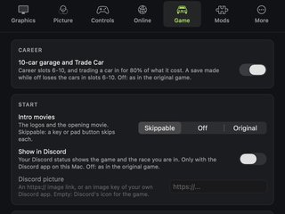</a><br><sub>Game</sub></td>
<td align="center"><a href="docs/readme/launcher/settings-mods.png">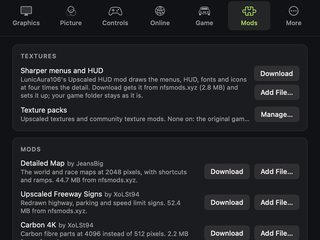</a><br><sub>Mods and languages</sub></td>
<td align="center"><a href="docs/readme/launcher/settings-more.png">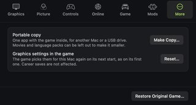</a><br><sub>More</sub></td>
</tr>
<tr>
<td align="center"><a href="docs/readme/launcher/quick-chat.png"></a><br><sub>Quick chat groups</sub></td>
<td align="center"><a href="docs/readme/launcher/texture-packs.png">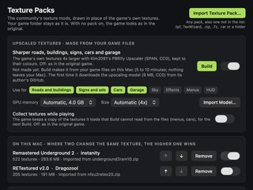</a><br><sub>Texture packs</sub></td>
<td align="center"><a href="docs/readme/launcher/upscaled-textures.png">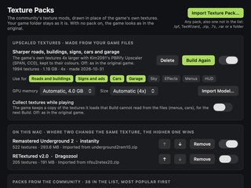</a><br><sub>Upscaled textures</sub></td>
<td align="center"><a href="docs/readme/launcher/saves-cloud.png">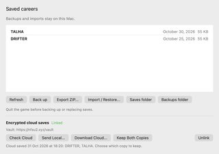</a><br><sub>Saves and cloud</sub></td>
</tr>
</table>

Parts of the runtime and tools are ported from th0mk's
[nfsu2-web](https://github.com/th0mk/nfsu2-web) (MIT License, Copyright (c)
2026 th0mk; portions copyright (c) 2026 Talha Müderrisoğlu). Files that come
from it say so in their header.

## Status

The game boots, reaches the menus, and races are playable with sound.

| Area | State |
|---|---|
| x86-32 → C lifter (integer, x87, MMX, SSE/SSE2, 3DNow!, string ops) | 23,278 functions, 137 MB of generated C |
| Win32 layer (CRT startup, heap, TLS, threads, files, registry, window) | working |
| Direct3D 9 → Metal, shader bytecode (vs/ps 1.x–2.x) → MSL | working |
| DirectSound → CoreAudio, DirectInput (keyboard, mouse, game controllers) | working |
| Videos (intro and story movies, decoded by the game itself) | working |
| Windowed, fullscreen, Retina-native and 1080p widescreen | working |
| Career mode: profile creation (name entry), save and load | working |
| LAN (hosting runs the game's own `server.dll`) and Online through a relay server | working, see [Multiplayer](#multiplayer) |
| Free roam with other players (Online) | working, see [Multiplayer](#multiplayer) |
| Horns between players, the other players' engines in free roam | working, see [Multiplayer](#multiplayer) |
| Double-clickable `.app` with a launcher window (`./pack.sh`) | working |
| Optional "HD" build: MSAA (2× at 1440 lines and above, 4× below), SSR, ray-traced reflections | working, see `GRAPHICS_RESEARCH.md` |

### Known limitations

- **Two builds of `SPEED2.EXE` are supported**, the European and the North
  American v1.2 ones (see [Game versions](#game-versions)); each has its own
  engine. Other builds would need their own lifting pass and address map.
- Keyboard, mouse and game controllers (Xbox / PlayStation / MFi); no wheel
  support.
- Structured exception handling is not implemented (`RtlUnwind` /
  `RaiseException` are stubs).
- x87 is modelled with 64-bit doubles, not 80-bit extended precision.
- One workaround with an unknown root cause remains: the front end's
  world-view-projection matrix arrives broken and an identity matrix is injected
  instead (`FIXMAT`, see `run.sh`).
- About 310 instructions in rarely used opcodes (many of them data the
  disassembler mistook for code) are still emitted as traps. None are hit in the
  measured race scene.
- Some visuals are unverified against a Windows reference (crowds / skinned
  meshes). See "Remaining graphics items" in `PROJECT.md`.

## How it works

```
SPEED2.EXE (PE32, x86)
   │  tools/reloc2.py     recover the relocation table  → out/relocs.txt
   │  tools/genall.py     recursive-descent discovery + tools/lift.py
   ▼                      x86 → C, one C function per guest function
gen/all/shard_*.c  (128 files) + fntab.c (guest address → native function)
   │  build.sh            clang -O3, in parallel
   ▼
runtime/  (hand-written)  CPU state, guest memory, Win32, D3D9→Metal, audio
   │  link.sh
   ▼
out/nfsu2_boot            ~35 MB arm64 Mach-O
```

- **Pointers vs. constants.** The hard problem of x86 static recompilation is
  telling a 4-byte address from a 4-byte number. This executable has its
  relocation *directory entry* zeroed, but the relocation *data* is still
  physically present in an unnamed section. `tools/reloc2.py` parses it by hand:
  91,106 absolute addresses, all of which point into the image. Function
  discovery and jump-table recovery are seeded from it.
- **Guest memory.** The 32-bit guest address space is reserved with `mmap`;
  guest→host translation is a single ARM64 addressing mode
  (`ldr w8, [x_base, w_addr, uxtw]`).
- **Indirect calls** go through an O(1) table indexed by guest address.
- **Code generated at run time.** The game writes small x86 thunks to its stack
  and calls them. `runtime/genexec.c` detects these and runs them in a small
  interpreter, handing calls back to lifted functions.
- **D3DX effects.** The statically linked D3DX9 effect framework took ~47% of
  guest time when executed as lifted code; `runtime/d3dx_hle.c` short-circuits
  parts of it (`D3DX_HLE.md`).

| Path | What it is |
|---|---|
| `tools/lift.py` | x86-32 → C lifter, with lazy EFLAGS (flag liveness) |
| `tools/genall.py` | function discovery, parallel generation, sharding |
| `tools/reloc2.py` | relocation table recovery |
| `tools/argcount.py` | stdcall argument counts for imports |
| `tools/isatest.py`, `tools/fuzzisa.py` | instruction-semantics tests and differential fuzzer |
| `runtime/cpu.h`, `mem.c`, `dispatch.c`, `genexec.c` | CPU state, guest memory, dispatch, run-time code |
| `runtime/win32.c`, `win32_ext.c`, `fileio.c`, `res.c` | Win32 API layer |
| `runtime/com.c`, `metal.m`, `vsemu.c` | Direct3D 9 / DirectInput / DirectSound COM layer, Metal renderer, shader translation |
| `runtime/audio.m` | CoreAudio output |
| `runtime/overrides.c`, `d3dx_hle.c` | hand-written replacements for specific game functions |
| `runtime/enhance.c` | HD build only (`-DNFS_ENHANCED=1`) |
| `runtime/bundle.m`, `pack.sh` | `.app` behaviour and packaging |
| `launcher/*.swift` | the app's launcher window (Swift/SwiftUI): finds and checks the game, Original/HD, portable copy, data mods |
| `tests/boot.c` | program entry point (runs the game from its PE entry point) |

## Verification

- **Instruction semantics:** 169 hand-written tests, 439 checks
  (`tools/isatest.py` → `out/isatest`).
- **Differential fuzzing against real x86:** `tools/fuzzisa.py` assembles random
  instruction sequences, runs them as real x86-64 code under Rosetta 2 and as
  lifted C on ARM64, and compares registers, flags and memory.
- **Function-level tests:** 15 checks against lifted game functions
  (`out/nfsu2_all`).
- **Reproducible generation:** the generated C is a pure function of the
  executable and the tools; regenerating gives byte-identical output.

`./run.sh test` runs the first and third.

- **Integrity run:** `tools/check.sh` plays both builds invisibly and silently
  from the menus into a Quick Race (~1.5 min each) and checks the end-of-run
  report: no unsupported instructions, no unresolved indirect calls, no broken
  matrices, no GPU command buffer errors, no missing mip levels, the race was
  actually reached, and in the HD build that ray tracing and the separate
  G-buffer pass ran.  Settings are restored and saves go to a temporary folder.
- **Unit suites:** `tests/run_suite.sh` runs every test that needs no game
  files (Win32 HLE, heap, watchdog, keyboard and pad, the Winsock harness and
  the WebSocket relay fixtures on loopback only, the free-roam core, headlights,
  shaders, save paths, texture packs, launcher models) and prints a summary.
- **Scripted scenarios:** `tests/run_suite.sh --game <outdir>` plays scripted
  runs of the real game (runtime/autotest.c, `tests/scripts/`) on either game
  version, plus the keyboard and pad suite, the game-folder-untouched proof,
  Discord, LAN and free-roam runs; `tests/README.md` lists them.

## Performance

Measured on an M1 Pro at 1280×960, same scene and settings, alternating runs
(method, raw numbers and caveats in `WINE_COMPARISON.md`):

| | This port | Wine 11.18 (wined3d, Rosetta 2) |
|---|---|---|
| Race | 119 fps (capped by the 120 Hz display) | 10–15 fps |
| 3D menus | 119 fps | 45 fps |
| CPU time per frame | ~12.6 ms | ~105 ms |

Power while racing at the display's native resolution (3024×1964, 120 fps,
M1 Pro, `powermetrics`, a real play session): the standard build draws about
**6.5 W** for CPU + GPU, stays at or below 70 °C and never spins the fans; the
HD build draws about 18 W.

## Requirements

- Apple Silicon Mac, macOS 11 or later. Developed on an M1 Pro, macOS 27.
- Xcode Command Line Tools (`clang`; `swiftc` for the launcher window).
- Python 3 with `capstone` 5.x and `pefile` (`requirements.txt`). NFSU2 Builder
  installs its own Python; only the command line tools come from Apple.
- Rosetta 2, only for `tools/fuzzisa.py`.
- Your own installation of the game, with one of these executables (both v1.2
  without the CD check, built Feb 9 2005):

  | Build | `SPEED2.EXE` size | SHA-256 |
  |---|---|---|
  | **European** (PAL) v1.2 | 4,788,224 bytes | `8f6a9ae2c4cfa01181d2fd755d99c6f4b7103f60273908ea1de1e719dfe2a297` |
  | **North American** v1.2 | 4,800,512 bytes | `f9dd86c054878ce6276beb07c1fd61874f7a1e4bf1f241b084c65b73e24168a7` |

  The app checks the file at startup, picks the matching engine and says so
  instead of crashing on any other file; `NFSU2_ANY_EXE=1` skips the check.

### Game versions

The recompiled code belongs to one executable, so every build of `SPEED2.EXE`
gets its own lifting pass and engine. The game *data* is a separate matter (see
the note under the table).

| `SPEED2.EXE` | Size | SHA-256 | Status |
|---|---|---|---|
| European v1.2, no CD check | 4,788,224 | `8f6a9ae2c4cfa01181d2fd755d99c6f4b7103f60273908ea1de1e719dfe2a297` | **Supported** (the reference build) |
| North American v1.2, no CD check (the build most PC mods target) | 4,800,512 | `f9dd86c054878ce6276beb07c1fd61874f7a1e4bf1f241b084c65b73e24168a7` | **Supported** (engines `nfsu2-engine-na`, `-na-hd`). Tested on US disc data from the menus into a Quick Race, original and HD. |
| US v1.0 retail disc | 5,987,981 | `2cbd698fee8338a13d1891bc17d27e6641b4b9dd40580de818594b9140222899` | **Cannot be supported.** Protected by SafeDisc: the code section is encrypted on disc and only decrypted at run time, so there is nothing to recompile. |

The retail disc executable carries the disc's copy protection, and EA's official
v1.2 patch keeps it: the patched European `SPEED2.EXE` (5,987,979 bytes, SHA-256
`7442cb462d043c2780ba80a7b84cb548320b4c8b36256993c5e6c28d4290f422`) still has
SafeDisc's `stxt774` and `stxt371` sections and encrypted code. The European v1.0
disc executable (5,987,980 bytes, SHA-256
`bf94f3664398bf33eb91bcecaba627893ffd20bb64d813c6e5b2b9f3062cd3ac`) is protected
the same way. A static recompiler needs readable machine code, so the port cannot
use a protected executable, and this project does not remove copy protection.
The official patch changes only `SPEED2.EXE`, `server.dll` and
`FRONTEND/FrontB.lzc`; the other 1,213 files of the European discs stay
byte-identical.

**Any region's data works with either supported executable.** The data can come
from the discs or an installation of either region; the runtime picks the region
from the data (below). NFSU2 Builder checks the data against the known releases in
`tools/known_releases.tsv` (paths, sizes and checksums only, written by
`tools/release_manifest.py`).

**Data from the discs.** The US discs and the European release share 1,218 of
their ~1,250 files byte for byte. The differences are the region's cars (the US
release has `CARS/CIVIC` and `CARS/RSX`; the European one has `CARS/CORSA` and
`CARS/PEUGOT106`), the per-language movies, `FRONTEND/FrontB.lzc` and
`server.dll`.

**US data works with the supported executable.** The game's region is a
constant in the executable (`0` in the US build, `6` in the European one), and
it decides which of the region-only cars exist. Left at the European value, US
data hangs on the "Loading" screen as soon as a race picks a Corsa or a 106. The
runtime therefore looks at the data at startup: if `CARS/CIVIC` and `CARS/RSX`
are there but `CARS/CORSA` and `CARS/PEUGOT106` are not, it switches the game to
the US region (log line `region: North American data`). Tested on US disc data:
races load, the Civic is in the Quick Race car list and the Mazda is called
Miata, as in the US release; the region check hides the Corsa and 106.
`NFSU2_REGION=na` or `eu` forces either region.

### Installing from the PC discs on a Mac

The discs hold the game in plain zip files, so the Windows installer is not
needed. With the two disc images (`.cue`/`.bin`, `.iso`, or the disc folders):

```bash
python3 tools/install_from_discs.py ~/Games/NFSU2 "Disc 1.cue" "Disc 2.cue"
```

The images are read directly (`tools/disc.py`, ISO 9660 and Joliet); 7-Zip is
only tried for an image that reader cannot open. NFSU2 Builder does this step
for you.

This writes a normal game folder (about 1.7 GB) that the launcher can point at.
It copies the disc's `SPEED2.EXE` too, but see the table above: the disc
executable cannot run, so put a supported one in its place. The North American
v1.2 executable is the natural match for US disc data; the European one also
works with it (see "US data works with the supported executable" above).

### How the North American build is made

The European executable is the reference: the runtime was written against it.
`tools/addrmap.py` matches the two executables function by function (a byte
signature with the parts that move between builds masked, aligned in order) and
collects data-address pairs from the matched code: 23,276 of 23,277 functions
match, most code is 16 bytes away from the European build, most data is at the
same address. Every game address in the runtime is written as `GA(0x…)` in
European terms; for the North American engine `runtime/build_na.h` (generated
from the map) turns each one, and each `sub_XXXXXXXX` name the runtime uses, into
the North American one. An address the map cannot place stops the build.

Two things differ at run time:

- The North American no-CD executable still looks for a CD-ROM drive (its disc
  contents check is patched out, the drive check is not) and otherwise asks for
  "Disc 2" forever. Its engine reports `D:` as an empty CD-ROM drive; paths on
  `D:` resolve to the game folder like those on `C:`.
- Its region variable is in `.bss` (0, the US) rather than a constant, see
  "US data works with the supported executable".

Function discovery missed eight call targets in this executable (its linear scan
stops on bytes an earlier, misaligned scan covered), which became traps;
`LIFT_MISSING=1` (set by `tools/gen_v2.sh` for this build) lifts such targets in
extra shards.

## Build from Terminal

[NFSU2 Builder](#nfsu2-builder) runs these same steps for players. This section
is for power users and LLM agents. Run everything from the repository root.

```bash
export NFSU2_DATA="/path/to/Need for Speed Underground 2"   # folder containing SPEED2.EXE
EXE="$NFSU2_DATA/SPEED2.EXE"

python3 -m venv .venv && .venv/bin/pip install -r requirements.txt

# 1) relocation table, cross-function flag liveness, lifting every function
#    to C, import argument table -> gen/all/   (~1 min on an M1 Pro)
#    The override and hook lists come from the runtime sources
#    (tools/genlists.py); after a runtime change that adds one, run it again.
tools/gen_v2.sh "$EXE"

# 2) compile the shards, then build the runtime and link   (~1.5 min)
./build.sh && ./link.sh

./run.sh test        # ISA + function tests
./run.sh             # windowed
./run.sh 1080p       # 1920x1080, widescreen-corrected
./run.sh hd          # HD build
./pack.sh            # out/NFSU2.app: launcher + both engines (Original and HD)
./pack.sh --zip      # also out/NFSU2.zip for a release
./pack.sh --embed    # out/personal/NFSU2.app with your game inside (do not share)
```

For the North American v1.2 executable the same steps build a second pair of
engines; `tools/gen_v2.sh` recognises the file by its SHA-256 and writes `gen/na`,
`run.sh` picks the engine by the executable, and `pack.sh` adds the engines to the
app when they are built:

```bash
tools/gen_v2.sh "/path/to/NA/SPEED2.EXE"       # -> gen/na
BUILD=na ./build.sh && BUILD=na ./link.sh       # -> out/nfsu2_na_boot, out/nfsu2_na_hd_boot
```

`runtime/build_na.h` is committed. `link.sh` regenerates it from
`out/na/addrmap.json` when that file exists, which takes both executables:
`tools/addrmap.py build <European SPEED2.EXE> <North American SPEED2.EXE> out/na/addrmap.json`.
Do this after adding a `GA(...)` address or a `sub_` name to the runtime; game
addresses written without `GA(...)` would be wrong in the North American engine.

The app opens a small launcher window first (`launcher/`, built by `pack.sh`
with `swiftc`): it finds and checks `SPEED2.EXE`, offers full screen, opens the
logs folder and manages saves (**Saves…**: the career profiles, backups, ZIP
export and import; the current saves are backed up before an import replaces
them; tests/save_manager.sh). **Settings…** (Cmd-,) holds the options on tabs:
Graphics (Original or HD, the HUD, frame rate, headlights, reflections), Picture
(the PC version's colour tint, console gamma, edge smoothing, sharpening; all off
by default, see `run.sh`), Controls, Online, Game, Mods and More, where **Make
Copy…** builds a portable app with the game files inside (APFS clones, seconds
on the same disk), so nobody needs `pack.sh --embed` or a terminal for that.
**Restore Original Game** sets every option back to the original, unmodified
game. Untick "Show this window when the app opens" to go straight into the game
(hold Option to get the window back). `NFSU2_SKIP_LAUNCHER=1` /
`NFSU2_ENGINE=original|hd` do the same from scripts. The Controls tab turns the
game controller on or off and sets what happens when it is unplugged, its stick
and trigger dead zones, the trigger buttons at full pull, the pad's menu keys
and reading it in the background (`NFSU2_PAD`, `NFSU2_PAD_DEADZONE`,
`NFSU2_PAD_TRIGGER_DEADZONE`, `NFSU2_PAD_TRIGGER_CLICK`, `NFSU2_PAD_FE_KEYS`,
`NFSU2_PAD_BACKGROUND`, which still win when set by hand; runtime/gamepad.m,
runtime/dinput_pad.c).  The keyboard follows the Mac's keyboard layout as
Windows would (typed characters, dead keys, Option as Alt), keys can be rebound
on the game's Controls page and the bindings are kept (runtime/keyboard_mac.m,
runtime/dinput_kbd.c).

The **Mods** tab adds a few PC mods that change the game's own data files, each
with a switch (off by default, which is the original game): JeansBig's
[Detailed Map](https://nfsmods.xyz/mod/4485), XoLSt94's
[Upscaled Freeway Signs](https://nfsmods.xyz/mod/7342) and
[Carbon 4K](https://nfsmods.xyz/mod/7401).  The mods are not part of the app:
**Download** fetches the tested release from the mod's page on nfsmods.xyz and
checks its SHA-256, **Add File…** takes a copy you already have.  The launcher
applies them (`launcher/DataMods.swift`: replacement files, and the parts of
nlgxzef's Binary scripts these mods use) into
`~/Library/Application Support/NFSU2/Mods/Files`, which the engine reads before
the game folder (`NFSU2_MODS`); the game folder is never changed.

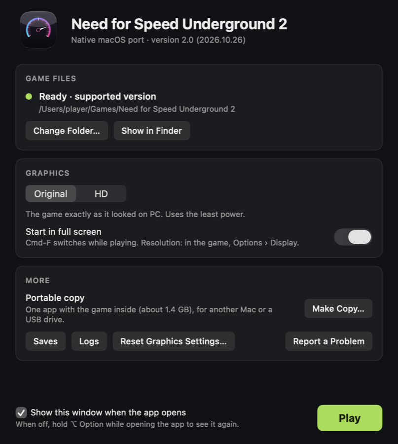

The launcher's Language row lists the languages the game folder has: its file in
`LANGUAGES`, or a language pack in `LANGPACKS/<language>` (laid out like the game
folder; a file there is read in place of the game's, for dubbed speech and movies
or languages the retail files lack). The app downloads nothing. The engine takes
it as `NFSU2_LANGUAGE` (`english`, `french`, `german`, `italian`, `spanish`,
`dutch`, `swedish`, `danish`, `korean`, `chinese`, `japanese`, `thai`, and
`russian`, `portuguese`, `polish`, `turkish`, `hungarian`, `ukrainian`, `czech`,
`slovak` from a pack), which still wins when set by hand.

Hungarian comes from GameHunter's translation (v1.1, 2005, by L_zooltan) and
Ukrainian from Clark X.'s (2022, kuli.com.ua). Their packs are one click in
Settings, Mods, Languages: the launcher downloads the translation's installer
from where its author's page links it, refuses anything but the release it was
tested with (size and SHA-256), and reads the files out of it without running
it (an Astrum InstallWizard installer for Hungarian, an Inno Setup one for
Ukrainian, `launcher/InnoSetup.swift`); Import... takes a local copy of the same
installer. Hungarian's text writes o and u with the double acute as o with the
tilde and u with the circumflex, as the translation does (the game's fonts have
neither); Ukrainian's is drawn with the Russian pack's fonts. Ported from th0mk's
nfsu2-web (MIT).

Czech comes from ROXOR's and PINĎA & syn's translation (v1.1, 2004), downloaded
in one click the same way from abcgames.cz (the zip it serves, size and SHA-256
checked, then the patch in it). It is a Clickteam Patch Maker patch, read without
running it (`launcher/Clickteam.swift`); Import... takes the zip, the
`nfsu2cz-v1.1.exe` in it or the folder it is in. Its text writes the letters with
the caron and u with the ring without them (c, r, s, z, e, u), as the
translation does: the game's fonts have only the acute ones. The translation was
made on the German text, so it had left some texts in German (gamepad help
lines, colours, countries, console and demo messages) and the movies' lines
empty, as German's dubbed text has them. The pack fills those in Czech, in the
translation's spelling (`launcher/CzechTexts.swift`), so Movie subtitles work in
Czech too.

Slovak comes from MixerX's translation (v1.0, 2011), downloaded in one click
from abcgames.cz as well: the zip of its installer for the European game, size
and SHA-256 checked, then each file it takes. The installer is an NSIS one, read
without running it (`launcher/NSIS.swift`); Import... also takes the one for the
American game, whose language files are the same. Its text has every Slovak
letter (in Windows-1250), drawn by the fonts' textures it comes with, and the
movies' lines. It replaces the Swedish files in the Windows game; here it takes
English's place, as the other packs do. Its own SPEED2.EXE and CD image are not
used: the engine shows the subtitles itself.

`run.sh` documents the environment switches; most are diagnostics.

`NFSU2_DISCORD=1` turns on Discord Rich Presence: while the Discord app is
running, your Discord profile shows that you are playing and what you are doing
(menus, race type and track, lap and position, career stage).
`NFSU2_DISCORD_DETAIL=minimal` shows only that you are playing. It is off by
default (in the app: **Show in Discord** in the launcher's More card); the game
talks only to the Discord app's local socket.

**Music** (Settings, Game tab): the game's own soundtrack (original), or a
folder of your music played through EA Trax (`runtime/radio.c`,
`radio_native.m`; `NFSU2_RADIO=1` and `NFSU2_MUSIC_FOLDER=<folder>`). macOS's
own decoders read the files (WAV, MP3, AAC/M4A, FLAC, AIFF, CAF and whatever
else it decodes), resampled to the game's mixer; a file that does not decode is
skipped. The EA Trax plaque shows each track's artist and title from its tags,
or from an "Artist - Title" file name. The game's music volume and pause still
apply, and nothing goes over the network. While a folder plays, the app menu's
**Music** submenu pauses, skips to the next track, shuffles, or goes back to the
game soundtrack (`radio_native.h` has the same controls for other panels).
Tests: `tests/radio_native.sh`; `tests/shop_music.sh` checks that the music
keeps playing after entering a shop.

**Photo mode** (`NFSU2_PHOTO=1`; launcher: Settings > Game > Photo mode, off by
default): while you drive offline, F12, Cmd+Shift+P or the pause menu's Photo
Mode stops the world and the race clock, hides the HUD and frees the camera
(orbit about a point up to 25 m from the car, from up to 30 m away, and a free
camera up to 50 m out; Tab switches between them, field of view, tilt, reset;
keys, mouse and controller, listed in a panel while it is on).  In free roam with
other players, N (a click of the right stick) shows the names over their cars and
your own, off at first. F12 or Space saves a PNG; F12 anywhere else
(menus, network races) saves a screenshot without holding the game up. The
pictures go to `~/Library/Application Support/NFSU2/Screenshots`
(`NFSU2_APPSUPPORT=<dir>` puts them in `<dir>/Screenshots`), and the launcher's
**Screenshots…** shows, exports and deletes them. **Drift mode in free roam**
(`NFSU2_DRIFT=1`; Settings > Game, off by default): X in the career's free roam
turns on the game's drift handling, drift camera and drift scoring, with a points
panel over the window; X again turns them off. The car then handles as in the
drift races, with its own Drift tuning from Performance Tuning / Dyno, and keeps
its nitrous (X neither empties nor fills it). Tests: `tests/native_scene.sh`,
`tests/photo_gallery.sh`, `tests/photo_drift.sh`.

While playing, **Cmd+Shift+D** writes the next frame as a PNG plus the full
draw list (to `~/Library/Logs/NFSU2/`), for reporting rendering problems.
### Multiplayer

The game's own LAN and Online modes run unchanged: `runtime/winsock.c` answers
Winsock 2 the way Windows does, so the bytes on the wire are the original
game's, and hosting a LAN game runs EA's `server.dll` from the game folder,
lifted as a second guest module at 0x00A00000 (`tools/gen_v2.sh` ->
`gen/server`, mapped and bound by `runtime/module.c`, its heaps in
`runtime/modheap.c`).

- **LAN** (the default): the Mac's own network, so Macs and Windows PCs on the
  same network play together.  macOS asks once for the Local Network
  permission.  The game lists only servers of its own region: a European and a
  North American game see each other when both have the same region
  (`NFSU2_REGION=eu` or `na` on one of them).
- **Online**: with **Play online** in the launcher (off by default), LAN and the
  game's Online menu go through a relay server, by default th0mk's
  `wss://nfsu2.xyz/lan`, the only one known so far (its source: th0mk/nfsu2-web,
  `web/server-rs`).  The server stands in for EA's long-gone Online servers and
  carries the virtual LAN; the player name is the Online name.  Environment:
  `NFSU2_NET=online`, `NFSU2_SERVER_URL`, `NFSU2_ROAM_NAME`.
- **Your name** (Settings, Online): the launcher asks the server what the player
  name is to you as you type it and before Play.  A player can claim a name with
  the keyphrase of cloud saves, as in the browser game; the server then keeps
  it, and anyone else under that name is shown to nobody in free roam and gets
  another name in the Online lobby.  For a name another player claimed, the
  launcher offers the name with four digits in place of its end (the browser
  game's choice).  **Claim** asks for the keyphrase (or makes one) and keeps it
  in Keychain; the server takes a claim only from a keyphrase with cloud saves,
  so with none yet it asks first and sends the careers once, encrypted on the
  Mac.  Cloudflare's check appears only when the server asks for it.  At Play
  the keyphrase's token goes to the game through a pipe, never the environment,
  and only to the server it was remembered with (`launcher/NameClaims.swift`,
  `runtime/net_native.m`).
  With no profile in the save folder yet, the game's name box for the first
  profile starts with the player name's letters and digits (7 at most) instead
  of NAME; one Enter takes it (`NFSU2_NEW_PROFILE_NAME`, `runtime/gamefix.c`).
- **Online statistics** (Settings, Online, with Play online; off by default, as
  in the original game): a small panel in the top-left corner of the game, under
  the frame-rate counter when that is on.  It shows the connection (connected,
  waiting in the server queue with the place in it, reconnecting, offline), the
  round trip to the server (the switch's ping and pong every 2 s), the players
  on the server, in free roam, in the Online lobby, in your room and in each
  crew (the server's `/players`, asked at the start and every 30 s, as **Check
  Player Counts** asks it), "Server busy: fewer cars shown" when the server
  says so, and in free roam with other players the cars shown near you and the
  players the server's hub links you with (`runtime/netstats.m`).  It never
  shows upload or download rates.  Environment: `NFSU2_NET_STATS=1`.
  Unit tests: `tests/netstats_unit.sh`.
- **LAN play through the server** tells it which UDP ports the game's sockets
  are bound to, so LAN broadcasts (the servers' adverts every 3 s) come only
  where a socket takes them (`runtime/net_relay.c`, `runtime/net_native.m`),
  and takes the server's list of players as what changed, not the whole list
  (some 190 KB on a busy server) every second.
- **Free roam with other players** (with Play online; Off, the default, is free
  roam as in the original game): the players in career free roam see each
  other's cars live, with their customization and names, on the minimap and
  the world map (which also marks up to 2048 more players of the room, moving
  while it is open), through the same server (`runtime/roam*.c`, from
  nfsu2-web, core version 11).  **Solid cars** can touch, **ghost cars**
  drive through each other, and **Everything ghost** lets the game's traffic
  and tuners drive through your car as well (no hits and no near-miss points
  from them), except a tuner you race in an outrun; an outrun between two
  players is solid only when both chose solid cars.  Game Tools' **Cars**
  menu switches between the three while you play.  **Players' cars shown**
  (16 to 48, 32 by default) sets how many other players' cars free roam
  draws near you, the nearest first; the server links you with as many
  players, and an outrun's other player stays linked however many players
  come between the two.  A car that stays in the air for two minutes in free
  roam (no wheel on the ground, upright and moving) takes its player off the
  server for the rest of that session, as a kick does, with a line saying
  so; the server hears why.  At a career race's marker the race card asks
  Solo or Multiplayer; Multiplayer opens a race lobby there that the others
  join with Enter, and the race is the game's own LAN race on that track,
  started in every game of the lobby at once (`runtime/mprace.c`); only its
  prize goes into the career.  Two players near each other can challenge
  each other to an outrun.  **Room**: only players with the same room name
  see each other; **Crew**: names and arrows of your crew in its colour at
  any distance.  **Invite links**: **Copy Invite Link** under Room copies the
  browser game's link to your room or to one of your crews
  (`https://nfsu2.xyz/#room=Blue%20Room`, a crew's with your room after it),
  and **Paste Invite Link** takes such a link from another player, asks, and
  sets the room or adds the crew (turning free roam on where it was off).  In
  a running game, Game Tools' **Room** changes the room at once: the old
  room's players go and the new one's come within a second (after an outrun,
  a lobby or a race, once it is over).  **Outrun tuners with other players** (on by default, as in
  the original game): the game's own tuners still come out to challenge you
  while other players are around, so their outruns and unique parts are there
  online too; within 30 m of you a tuner comes first, and at a door or an
  event no tuner challenges you.  Off: they stay away while another player's
  car is in your world.  **Friends in free roam** (with a claimed name; on by
  default, off is the original game): touch front bumpers with another player
  for 3 s and a line under the middle of the picture offers **Add Bo as a
  friend** (F, or Game Tools' button), or **Bo wants to be friends: accept**;
  once both said yes you are friends, on the server's friends lists (EA
  Messenger's, the same as in the browser game).  Friends' names and arrows
  show in a pale lime at any distance, the server links friends first, a
  notice says when one comes into free roam, and Game Tools' **Join friend**
  drives you into their room.  Settings > Online > **Friends** lists them with
  where each one plays (free roam and its room, the Online lobby, offline),
  answers requests, removes a friend, takes a request back and asks a player
  by name (the server's `/friends`, with the keyphrase's token, only to the
  server it was remembered for).  **Players in the world map's legend** (on by
  default; off is the original game): the legend gets two rows more, Players
  and Players' races, and Enter on one leaves the other players' markers (a
  crew-mate's stays) or their race lobbies (yours stays) off the map; the
  game's registry keeps the choice.  The race lobbies' labels are smaller and
  go beside their icon where they cover no other icon.  **Tuners grey on the
  maps** (on by default; off is the original game's orange): the game's own
  outrun challengers are light grey on the minimap and the world map (the
  legend's Opponent Car too), so they are not taken for players.
  Environment: `NFSU2_ROAM=1`, `NFSU2_ROAM_COLLIDE`, `NFSU2_ROAM_ROOM`,
  `NFSU2_ROAM_CREW`, `NFSU2_ROAM_TUNERS=0`, `NFSU2_ROAM_MAP_FILTER=0`,
  `NFSU2_ROAM_AI_GREY=0`, `NFSU2_ROAM_FRIENDS=0`.
- **Horns and the other players' car sounds** (with Play online; both off by
  default, as in the original game, which has no horn): the launcher's
  **Horn** picker gives the player a horn (dual, single, truck, train, klaxon,
  La Cucaracha, clown, sad trombone) on N; the others hear it from that car in
  free roam and in Online races, and the game's Audio options get a Horn
  Volume slider (`runtime/horn.c`, `racehorn.c`, `hornmenu.c`, from
  nfsu2-web).  **Hear other players' cars** plays the other players' engines,
  nitrous and hydraulics in free roam with the game's own sounds
  (`runtime/carsfx.c`).  Environment: `NFSU2_HORN=<horn>`,
  `NFSU2_ROAM_CARSFX=1`.  Unit tests: `tests/horn_unit.sh`.
- **Quick chat** (with Play online; off by default, as in the original game):
  four groups of four phrases (**Quick chat groups...**, also in Game Tools,
  Cmd+Shift+M); 1-4 opens a group and 1-4 again says a phrase, or flick the
  right stick twice.  In free roam it shows over your car to the players
  near you and in your race lobby (`runtime/native_controls.m`,
  `roam_game.c`).  In every race between players online (the Online and LAN
  menus' races and free roam's race lobbies, with free roam on or off) it
  works while driving and on the results and goes to everyone in the race,
  shown in a chat on the left of the picture; the race's creator passes each
  joiner's on to the others, beside the horns (`runtime/racehorn.c`, from
  nfsu2-web).  At most three phrases in six seconds, the same one again
  within two seconds is not shown; never in a career race or a Quick Race.
  Off, nothing is said, shown or passed on, and the keys and the stick are
  the game's.  Environment: `NFSU2_ROAM_SAY=1`, `NFSU2_QUICKCHAT_GROUPS`,
  `NFSU2_QUICKCHAT_PHRASES`.  Unit tests: `tests/native_controls.sh`,
  `tests/horn_unit.sh`.
- `NFSU2_NET=off` turns networking off; `NFSU2_NET=loopback` confines it to
  127.0.0.1 for two games on one Mac (see the top of `runtime/winsock.c`).

`tools/session.sh [hd]` records a play session (frame times, CPU/GPU power,
temperature, fan speed, screenshots) and `tools/session_report.py` turns it into
a report.

**Cmd-N** shows a frame-rate counter in the top-left corner: frames per second,
frame time and a frame-time graph; pressed again it adds the 1% low, the GPU time
per frame, the render size and MSAA, a third time hides it. The choice is kept
for the next start (`NFSU2_FPS_COUNTER=off|on|detailed` for one run). The
launcher's Graphics card has the same choice (**Frame-rate counter**).

**Sharper menus and HUD.** LunicAura106's
[Upscaled HUD](https://nfsmods.xyz/mod/4319) mod redraws the menus, HUD, fonts,
icons and logos at four times their size. It is not part of this repository: in
the launcher's Graphics card, **Download** fetches it from the mod's page on
nfsmods.xyz (2.8 MB, checked against the release this was made for), or **Add
File…** takes a copy of `NFSU2UHUD11192022a.7z` you already have. The launcher
makes `uhud.pak` from it in `~/Library/Application Support/NFSU2/Textures/` and
leaves the game folder as it is; the switch that then appears turns the mod on
(off is the original game). While
playing, **Cmd-T** switches between the mod's textures and the game's own. From
the command line: `NFSU2_UHUD=on`, with the pack in `NFSU2_UHUD_PACK` or in the
game folder's `TEXPACKS/uhud.pak` (runtime/texrep.m).

**Texture packs.** The launcher's Texture Packs window (**Manage…** in the
Graphics card) handles the community's texture mods: TexMod packs (`.tpf`),
TexWizard packs, mods that replace the game's texture files, and DDS or PNG files
named after the game's textures. None of them is part of this repository.
**Import Texture Pack…** takes any of them, as downloaded (`.zip`, `.7z`, `.rar`,
`.tpf` or a folder). The window also lists 38 popular packs (nfsmods.xyz's most
viewed NFSU2 texture and interface mods, and large packs hosted elsewhere) with a
search and categories; **Details** opens a pack's page. The 27 releases that were
tested with this port on both game versions have **Download**, which fetches that
release from the author's page and checks it by SHA-256; the others are
downloaded on their page and imported. The launcher makes one pack file per mod
in `~/Library/Application Support/NFSU2/TexturePacks/` and leaves the game folder
as it is; a mod with a symbolic link in it is refused. Each pack has its own
switch; where two change the same texture, the higher one in the list wins, and
the Upscaled HUD comes after all of them. With no pack on, the game looks as in
the original. The engine draws a pack's texture in place of the game's own, which
keeps its own size, so the game never sees the larger textures. **Cmd-T** while
playing switches between the packs' textures and the game's own. From the command
line: `NFSU2_TEXPACKS=<pack>[:<pack>...]`.

**Upscaled textures.** The top of the Texture Packs window makes a pack of the
game's own textures at four times their size (two times on a Mac with less than
16 GB of memory) from your game files, on your Mac: **Build** reads the textures
of the game's bundles, upscales them on the GPU with Kim2091's
[PBRify Upscaler SPAN v4](https://github.com/Kim2091/PBRify_Remix) (CC0), keeps
each texture's colours and alpha, corrects the result until it averages back to
the original texel for texel, and writes it in the texture's own block format
(about 2000 textures, 1.2 GB at 4x; 5 to 10 minutes on an M1 Pro). The model is
not part of this repository: the first Build downloads it (9 MB) from its author's
repository at the tested commit and refuses any file with another SHA-256; **Import Model…**
takes a copy you have. No Python is needed and nothing leaves the Mac. Its switch
is off by default (the original game); which parts it is used for (roads and
buildings, signs, cars and garage by default), the GPU memory it may take and
the size are in the same card, and **Collect textures while playing** keeps a copy
of the textures the game loads from its compressed bundles (menus, cars) for the
next Build. The engine puts the game's own mip levels under the larger ones, so
wherever the game draws a texture at or below its own size it looks as before.
The Texture Packs and the Upscaled HUD win over it where both change a texture.
From the command line: `NFSU2_TEXTURES=upscaled NFSU2_TEXPACK=<folder>`, with
`NFSU2_TEXPARTS`, `NFSU2_TEXBUDGET` (MB) and `NFSU2_TEXDUMP=<folder>`
(runtime/texrep.m); a folder of DDS files named `<anything>_<XXH3-64 of level 0>.dds`
works as such a pack too. `tests/upscale_pack.sh` and `tests/texture_unit.sh` test
the builder and the engine side.

The list is `launcher/texture-packs.json`, built into the app. When the window
opens, the launcher also reads the same file from this repository's main branch
(once per launch, over HTTPS, checked strictly) and keeps the last good copy, so a
pack whose author uploads a new file is fixed by a one-line change to that file,
with no new app release; a download is always checked against the list's SHA-256.
`tools/check_texpacks.py [--full]` says which downloads still serve the tested
file. `tests/texture_packs.sh` checks that mods with links are refused, that the
list falls back to the app's own copy when the fetched one is missing or invalid,
and that Download refuses any other file.

## FAQ

**Can I play Need for Speed: Underground 2 on a Mac?**
Yes, on an Apple Silicon Mac (M1 or later) with your own copy of the PC game.
Get NFSU2 Builder from this fork's [Releases page](https://github.com/007hacky007/NFSU2-macOS-native/releases/latest) and let it build
`NFSU2.app` from your game copy ([NFSU2 Builder](#nfsu2-builder)), or build it from
Terminal (`./pack.sh` produces a double-clickable `NFSU2.app`). Open it, click Play. Menus, races, career saves and sound
work.

**Do I need Wine, CrossOver, Whisky, Parallels or a virtual machine?**
No. The game's code is recompiled to native ARM64 and runs directly on macOS.
Rosetta 2 is not used to run the game (only, optionally, by one test tool).

**Is it faster than Wine or CrossOver?**
On an M1 Pro at 1280×960: 119 fps in races (capped by the 120 Hz display)
against 10–15 fps under Wine 11.18 with Rosetta 2, and 119 fps against 45 fps
in the 3D menus. Method and raw numbers are in `WINE_COMPARISON.md`.

**Is there a ready-made download?**
Not of the game app in this fork: this fork's [Releases page](https://github.com/007hacky007/NFSU2-macOS-native/releases/latest) has
NFSU2 Builder, which makes `NFSU2.app` on your Mac from your own `SPEED2.EXE`
(see [NFSU2 Builder](#nfsu2-builder)). The app it builds holds both graphics
modes, Original and HD (MSAA, ray-traced reflections), chosen in its Settings, and
your game inside it, so nothing else is needed to play. Upstream's Releases page has upstream's own builds, without this
fork's features.

**Can I carry the game to another Mac in one piece?**
Yes. An `NFSU2.app` made by NFSU2 Builder already has the game inside: move or copy it
anywhere. In the app's Settings (More tab), **Make Copy…** creates "NFSU2 Portable.app" with the
game files inside: about 1.4 GB, plus the movies (1.1 GB) and the language packs in `LANGPACKS` if the game folder has them. Untick those when saving it for a smaller copy. It runs on its own; saves stay in
`~/Library/Application Support/NFSU2 Saves` on each Mac. It contains the game,
so keep it for yourself.

**Which version of the game does it need?**
The Windows PC version, with the European or the North American v1.2
`SPEED2.EXE` listed under [Requirements](#requirements). The US v1.0 disc
executable cannot be supported (it is copy-protected). Console versions are not
supported. See [Game versions](#game-versions).

**I only have the PC discs. Can I install them on a Mac?**
Yes, without Windows: choose both disc images in NFSU2 Builder, together with a
supported `SPEED2.EXE`, or run `tools/install_from_discs.py`. See [Installing from
the PC discs on a Mac](#installing-from-the-pc-discs-on-a-mac).

**Does it work on Intel Macs?**
No. Only Apple Silicon is targeted and tested.

**What does not work yet?**
There is no wheel support and no online play.
See [Known limitations](#known-limitations).

**How is this different from other NFSU2 projects?**

| Project | Approach | Platforms |
|---|---|---|
| **NFSU2Recomp** (this) | Recompiles the PC executable with its own x86 → C lifter; own Direct3D 9 → Metal renderer | macOS (Apple Silicon) |
| [OpenUG2](https://github.com/whoismept/OpenUG2) | Reimplements the engine from scratch and reads the game's data files; does not run the original code | Linux, macOS, Windows |
| [nfsu2-recompiled](https://github.com/codepdbh/nfsu2-recompiled) | Recompiles the PC executable with pcrecomp; Direct3D 9 through DXVK | Windows, Android |
| [nfsu2-sw](https://github.com/antoxa2584x/nfsu2-sw) | Recompiles the original Xbox version with xboxrecomp | Nintendo Switch, Linux |

## Related work

Static recompilation of x86 is not new, and this is not the first project to do
it:

- [M-HT/SR](https://github.com/M-HT/SR) statically recompiles DOS and Windows
  game executables (Septerra Core, Battle Isle 3 and others) at assembly level,
  for targets including macOS arm64.
- [sp00nznet/xboxrecomp](https://github.com/sp00nznet/xboxrecomp) lifts original
  Xbox (x86) games to C with a Python + Capstone pipeline very similar to this
  one.
- [N64: Recompiled](https://github.com/N64Recomp/N64Recomp) and
  [XenonRecomp](https://github.com/hedge-dev/XenonRecomp) established the
  approach for MIPS and PowerPC consoles, and are where the method here comes
  from.
- McSema, rev.ng, RetDec and BinRec are IR-based binary lifters from the research
  side.

What this project adds is narrower: recovering a relocation table whose
directory entry was zeroed and using it to separate pointers from constants; a
differential instruction fuzzer that uses Rosetta 2 as the oracle; a hybrid
interpreter for x86 code the game generates at run time; and an end-to-end,
playable Win32 + Direct3D 9 → macOS ARM64 + Metal port of a 23,000-function 3D
game.

## Documentation

- `PROJECT.md` — chronological engineering log: findings, bugs and root causes,
  measurements.
- `D3DX_HLE.md` — high-level emulation of the D3DX effect framework.
- `GRAPHICS_RESEARCH.md` — graphics research and the HD build.
- `LIFTER_EFFICIENCY.md` — lifter efficiency work and measurements.
- `WINE_COMPARISON.md` — comparison against Wine.
- `LITERATURE.md` — related work.
- `screenshots/report/nfsu2-report.html` — illustrated project report.

## How this was built

Development was carried out with an AI coding assistant (Claude Code) under the
direction of the project owner. Goals, constraints and priorities, observations
from playing the game, Windows reference material and direction decisions came
from the project owner; implementation, measurement and debugging were done
together with the assistant.

## Legal

Copyright (c) 2026 Talha Müderrisoğlu. All rights reserved.

This repository is **not open source**. You may download, build, run and
modify it for your own personal, non-commercial use with your own copy of the
game. Publishing, distributing or sharing it — or any modified version, port,
fork or build of it — and any commercial use require prior written
permission. See `LICENSE`.

**Permission:** to publish, share or build on this code, ask first by opening
an issue in this repository.

**License history:** early versions of this project were published under the
MIT License, and a license change became necessary later. Anyone who obtained
those early versions under the MIT License may keep using them under its
terms; the license above applies to the current version and everything after
it.

This project is not affiliated with or endorsed by Electronic Arts. *Need for
Speed* and *Need for Speed: Underground 2* are trademarks of Electronic Arts
Inc. The repository contains none of the game's code or data. Screenshots show
the game running through this port and are included for documentation; the
game content in them belongs to its owners.
